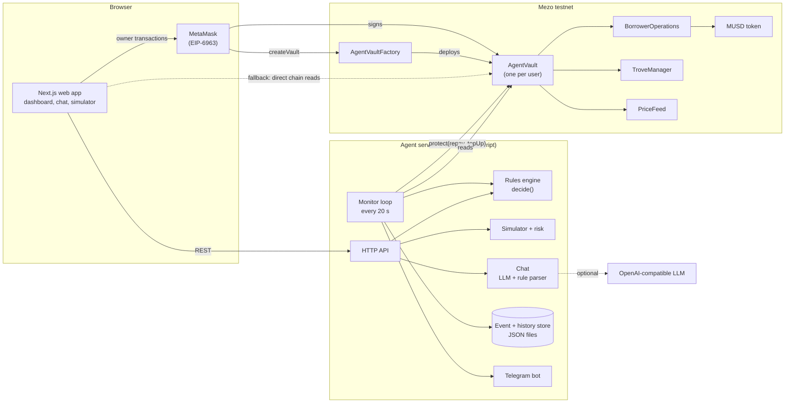
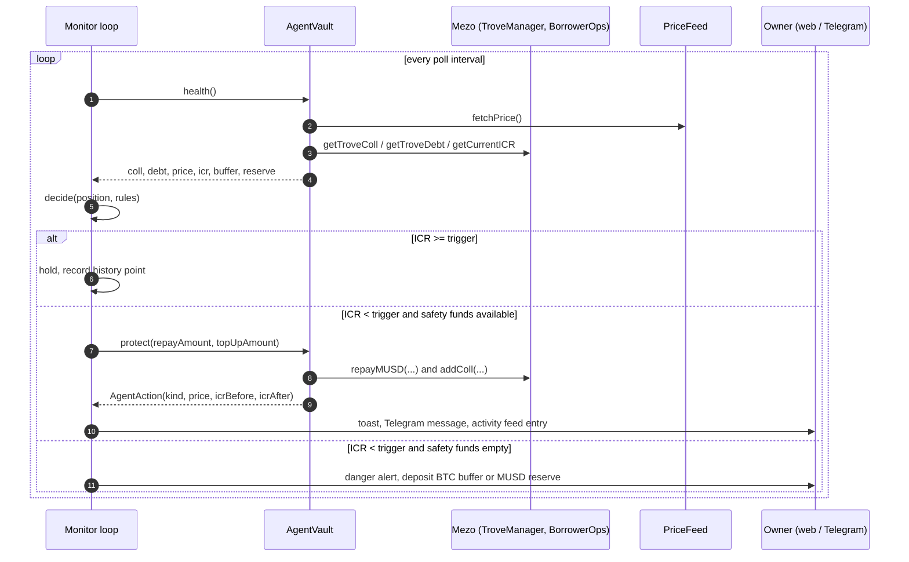
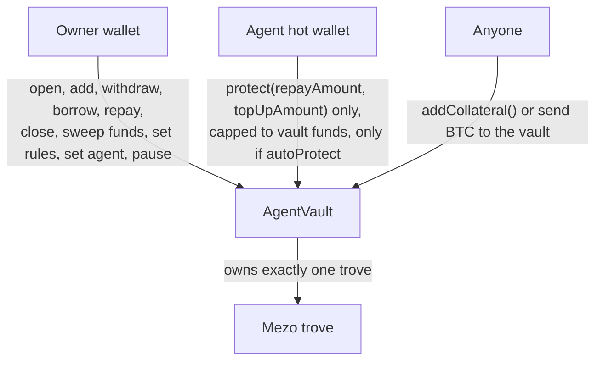
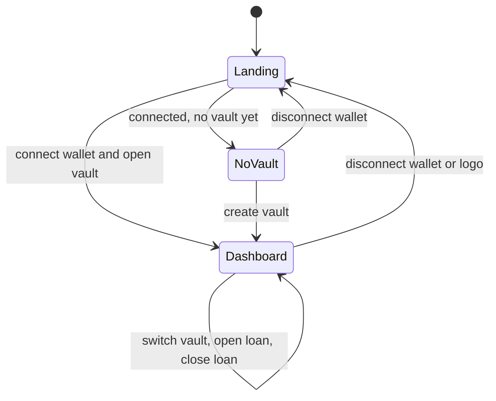
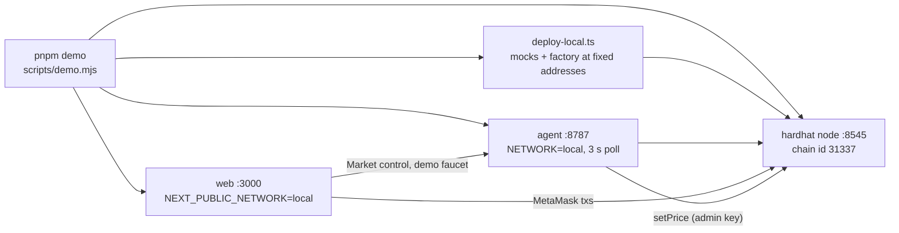

# AgentVault

**An autonomous guardian for Bitcoin-backed MUSD loans on Mezo.**

AgentVault gives every borrower a personal vault contract that owns one Mezo trove. The owner
pre-funds a BTC buffer and a MUSD reserve inside the vault and sets two numbers: *when to act*
(trigger ICR) and *where to restore to* (target ICR). An agent service watches the trove and the
on-chain BTC price. When the collateral ratio falls below the trigger it calls `protect()`, and the
vault adds BTC collateral or repays MUSD debt so the loan never reaches the 110% liquidation line.

The agent has exactly two powers (add collateral, repay debt) and can only spend what already sits
inside the vault. It cannot withdraw, move MUSD out, change rules or close the loan.

**Wave 2:** the MUSD reserve no longer sits idle. It earns BTC in the **Mezo Stability Pool**, the
agent pulls it back out to repay when the loan is in danger, and liquidation gains are harvested
straight into the loan as extra collateral. See [What changed since Wave 1](#what-changed-since-wave-1).

Built for the **Mezo Buildathon (Track 1: DeFi, with Track 2 Telegram access)**.

### Wave 2 at a glance

> **A real agent rescue on Mezo testnet that pulled MUSD back out of the Mezo Stability Pool to save the loan.**
> ICR **118.9% → 140.0%**, Stability Pool deposit **420 → 249.6 MUSD**, one `protect()` call by the agent:
> [`0x3b9d40dd…c0d389`](https://explorer.test.mezo.org/tx/0x3b9d40dd6d96248b563fce7a0d1d8ab3aca7668dbe347f33d2061a9cc4b0d389)

| | Wave 1 | Wave 2 |
|---|---|---|
| MUSD reserve | Sat idle in the vault | **Earns BTC in the Mezo Stability Pool**, unwound by the agent on a rescue |
| Mezo primitives used | Trove, PriceFeed | Trove, PriceFeed, **StabilityPool**, **claimCollateral**, **minNetDebt** |
| Redemption | Surplus BTC could get stuck | **`claimSurplus()`** recovers it to the owner, the agent calls it automatically |
| Rescue near min debt | Could revert | **`maxRepay()`** clamps on-chain and in the rules engine |
| Business model | None | **0.5% per rescue, 10% of pool gains**, hard capped in the contract |
| Contract tests | 8 | **23** (plus 20 end-to-end checks) |
| Testnet proof | Two rescues from the buffer and reserve | **Rescue that unwinds the Stability Pool** on a fresh v2 factory |

| | |
|---|---|
| Live app | **https://agentvault-90fz.onrender.com** (Mezo testnet; the free host sleeps when idle, so the first load can take about a minute) |
| Chain | Mezo testnet, chain id `31611` (plus a local demo network, chain id `31337`) |
| MUSD integration | Real Mezo trove via `BorrowerOperations` and `TroveManager`; MUSD reserve earns in the Mezo `StabilityPool` and repays debt; `claimCollateral` recovers redemption surplus |
| Live contracts | Wave 2 factory [`0xe211B90736A3995e4C57f560724C265d5C60C538`](https://explorer.test.mezo.org/address/0xe211B90736A3995e4C57f560724C265d5C60C538), demo vault [`0x17f31926284BB7e36b272eCdd250fBfD3059366E`](https://explorer.test.mezo.org/address/0x17f31926284BB7e36b272eCdd250fBfD3059366E). Full record in [`contracts/deployments/31611.json`](contracts/deployments/31611.json). Wave 1 factory `0x0Eb2cD465946e7eac309bCF311Dbd2Dd5cc7C31d` still works |
| Proof | Wave 2 Stability Pool rescue plus the two Wave 1 rescues, see [Live proof](#live-proof-on-mezo-testnet) |
| Stack | Solidity (Hardhat), TypeScript, Fastify, viem, Next.js 15, Tailwind, three.js, grammY |

---

## What changed since Wave 1

Every item below answers a point from the Wave 1 judge review.

| Wave 1 feedback | Wave 2 change | Where |
|---|---|---|
| Give the idle MUSD reserve a sound productive use the agent can unwind | **Earn:** the reserve is deposited into the Mezo **Stability Pool** (`provideToSP`). It earns the BTC of liquidated troves. `protect()` unwinds just the missing MUSD (`withdrawFromSP`) before repaying. `harvest()` adds the BTC gains to the trove as collateral. The agent keeps 30% liquid and pools the rest by itself | `AgentVault.earnDeposit / earnWithdraw / harvest / protect`, agent `monitor.ts` |
| Add a `claimCollateral` passthrough so a redeemed vault keeps its surplus BTC (High finding) | **`claimSurplus()`** calls Mezo `BorrowerOperations.claimCollateral()` and sends the BTC to the owner. The agent calls it automatically after a redemption | `AgentVault.claimSurplus`, agent housekeeping |
| Cap repayments at the 1800 MUSD minimum net debt so `protect()` does not revert | **`maxRepay()`** = debt − 200 MUSD gas compensation − `minNetDebt`. `protect()` clamps to it on-chain and the shared rules engine never asks for more | `AgentVault.maxRepay`, `shared/src/rules.ts` |
| Verify the factory and vault on the Mezo explorer | Tried every route: the Hardhat plugin, the Blockscout v2 standard JSON API and flattened source. We rebuilt for the `london` EVM because the Mezo verifier offers nothing newer, and the deployed bytecode matches our build byte for byte, but the explorer still answers *Unable to verify*. **Not verified yet.** The exact compiler input is committed so anyone can reproduce the bytecode | `contracts/verify/`, `contracts/scripts/verify.ts` |
| A stated revenue model would lift the product score | **Fees, fixed at deploy and hard capped in the contract:** 0.5% of each rescue (cap 1%) and 10% of Stability Pool BTC gains (cap 20%). A failed fee transfer never blocks a rescue | `AgentVault._payFee`, [Revenue model](#revenue-model) |
| Add a pitch deck | Deck linked from the AKINDO page | [SUBMISSION.md](SUBMISSION.md) |

Also new in Wave 2:

- `closeLoan()` pulls pooled MUSD back out of the Stability Pool to pay the debt and returns leftover MUSD to the owner.
- Mezo blocks pool withdrawals while any trove sits below 110%. `protect()` catches that (`EarnUnwindFailed`) and falls back to the liquid reserve and the BTC buffer instead of reverting. This is why the agent keeps a liquid share.
- The agent serializes all of its transactions, which fixes a nonce race between the poll loop and API-triggered checks.
- The dashboard has an **Earn** card (pooled vs liquid reserve, BTC earned, harvest, repay limit, fees, redemption alert with a claim button). The chat explains Earn and fees.
- Tests: 8 → **23** contract tests, new rules tests, end-to-end checks 14 → **20** (all passing). See [Testing](#11-testing).
- Wave 1 vaults keep working: `health()` is unchanged and the agent and dashboard detect v2 features with `earnInfo()`.

### What live testnet taught us (and what we fixed)

Running the Wave 2 flow on real Mezo testnet surfaced problems the mocks never show:

| Found on testnet | Fix |
|---|---|
| A rescue ran out of gas at 7.9M of 8.07M. Cause: Mezo's `repayMUSD` and `addColl` with empty hints walk the sorted trove list, which costs 6M+ gas | The agent sends every write with a 60% gas margin on top of the estimate, and the proof scripts set explicit limits |
| The testnet RPC sometimes estimates about 21k gas for a call that needs millions, which the node then rejects | Explicit gas limits on every owner and agent write in the scripts |
| A demo trove we pushed to 119% was **closed by someone's redemption** before the agent ran: Mezo redeems the lowest ICR troves first | This is exactly the case `claimSurplus()` exists for. The proof script now stops just under the trigger, rescues at once, and refuses to act on a closed trove |
| The Mezo explorer verifier lists no EVM version newer than `london` | Contracts are now compiled for `london` |
| A price move changes ICR by itself, so an ICR rise is not proof of a rescue | Every confirmation checks a debt drop or a balance change, never ICR alone |

## Revenue model

| Stream | Rate | Cap (in contract) | Paid in | When |
|---|---|---|---|---|
| Protection fee | 0.5% of the MUSD repaid and BTC added | 1% | MUSD and BTC | Only when the agent actually rescues the loan |
| Performance fee | 10% of Stability Pool BTC gains | 20% | BTC | When gains are harvested or withdrawn |

Fees go to a treasury address fixed in the factory. Neither the rates nor the recipient can be
changed after deploy. Users pay only for value created: a rescue or real yield.

---

## Table of contents

1. [The problem](#1-the-problem)
2. [Mezo and MUSD integration](#2-mezo-and-musd-integration)
3. [System architecture](#3-system-architecture)
4. [Smart contracts](#4-smart-contracts)
5. [Agent service](#5-agent-service)
6. [Web application](#6-web-application)
7. [Networks: Mezo testnet and the demo network](#7-networks-mezo-testnet-and-the-demo-network)
8. [Getting started](#8-getting-started)
9. [Configuration reference](#9-configuration-reference)
10. [HTTP API reference](#10-http-api-reference)
11. [Testing](#11-testing)
12. [Security model](#12-security-model)
13. [Known limitations](#13-known-limitations)
14. [Live proof on Mezo testnet](#live-proof-on-mezo-testnet)
15. [Buildathon fit](#15-buildathon-fit)
16. [Roadmap](#16-roadmap)
17. [Repository layout](#17-repository-layout)

---

## 1. The problem

A Mezo trove is liquidated when its individual collateral ratio (ICR) falls to **110%**. The
borrower has to watch the ratio around the clock. One bad night turns a price dip into a
liquidation and the loss of the collateral.

| | Manual | AgentVault |
|---|---|---|
| Monitoring | You, 24/7 | Agent, every 20 s (3 s on the demo network) |
| Reaction | After you notice | At your trigger ICR |
| What can move funds | Your wallet, your keys | Vault-local safety funds only |
| Auditability | Scrollback | Every decision and transaction logged and exportable |
| Control | Everything, all the time | Owner kill switch, two agent powers only |

---

## 2. Mezo and MUSD integration

AgentVault does not wrap or mock Mezo on testnet. Each vault **is** a Mezo borrower: the vault
contract is the trove owner and talks to the protocol directly.

| Mezo contract | Functions the vault or agent uses | Why |
|---|---|---|
| `BorrowerOperations` | `openTrove`, `addColl`, `withdrawColl`, `withdrawMUSD`, `repayMUSD`, `closeTrove`, `minNetDebt`, `getBorrowingFee` | Open, defend, adjust and close the loan |
| `TroveManager` | `getTroveColl`, `getTroveDebt`, `getTroveStatus`, `getCurrentICR` | Read the live position and the exact ICR Mezo uses |
| `PriceFeed` | `fetchPrice` | The same oracle price that decides liquidation |
| `MUSD` (ERC-20) | `balanceOf`, `approve`, `transfer`, `transferFrom` | Borrowed asset, and the reserve that repays debt |
| `StabilityPool` (Wave 2) | `provideToSP`, `withdrawFromSP`, `getCompoundedMUSDDeposit`, `getDepositorCollateralGain` | The idle MUSD reserve earns liquidated BTC; the agent unwinds it to repay |
| `BorrowerOperations.claimCollateral` (Wave 2) | `claimCollateral` | Recover surplus BTC from the `CollSurplusPool` after a redemption |

How MUSD is used:

1. The loan is MUSD minted from a Mezo trove.
2. The **MUSD reserve** held in the vault is spent by the agent to repay debt (`repayMUSD`).
3. The **BTC buffer** is spent to add collateral (`addColl`).
4. The agent compares against Mezo's own `getCurrentICR`, so the decision matches what the
   liquidation engine will see.
5. **Wave 2:** the reserve sits in the Mezo Stability Pool. It backs Mezo's liquidation engine
   while it waits, earns BTC from liquidations, and is pulled back out when this loan needs it.
   Repays are capped at Mezo's minimum net debt (1800 MUSD + 200 MUSD gas compensation).

Composability: AgentVault sits on top of an existing Mezo product (Mezo Borrow) and extends it
with automation, rather than being a standalone app. The vault is a normal contract, so other
protocols can hold, read or wrap it.

---

## 3. System architecture

### 3.1 Components



The web app reads from the agent for history, risk and chat, and **falls back to reading the vault
straight from the chain** (with the same shared rules engine) when the agent is unreachable, so
the dashboard never shows a different truth than the contract.

### 3.2 One protection cycle



### 3.3 Roles and what each can do



### 3.4 Screens in the web app



---

## 4. Smart contracts

Solidity 0.8.24, OpenZeppelin 5, Hardhat. Source in [`contracts/contracts`](contracts/contracts).

### 4.1 `AgentVaultFactory`

Deploys one isolated `AgentVault` per call and indexes them by owner.

| Function | Description |
|---|---|
| `createVault(agent, triggerICR, targetICR)` | Deploys a vault owned by `msg.sender`, `autoProtect = true` |
| `getVaults(owner)` | All vaults of an owner |
| `vaultCount()` | Total vaults |
| Event `VaultCreated(owner, vault, agent)` | Indexed for discovery |

### 4.2 `AgentVault`

| Function | Caller | What it does |
|---|---|---|
| `openLoan(debt)` payable | owner | Opens the Mezo trove with `msg.value` as collateral and sends the minted MUSD to the owner |
| `addCollateral()` payable | anyone | Adds BTC to the trove (anyone may top a vault up) |
| `repay(amount)` | owner | Pulls MUSD from the owner and repays debt |
| `borrowMore(amount)` | owner | Borrows more MUSD to the owner |
| `withdrawCollateral(amount)` | owner | Takes collateral out of the trove to the owner |
| `closeLoan()` | owner | Closes the trove and returns all BTC held by the vault |
| `fundReserve(amount)` | owner | Moves MUSD into the vault as the agent's reserve |
| `sweepMUSD(to, amount)` / `sweepBTC(to, amount)` | owner | Takes unused safety funds back out |
| `setRules(trigger, target, autoProtect)` | owner | Updates the rules and the kill switch |
| `setAgent(agent)` | owner | Rotates the agent address |
| `protect(repayAmount, topUpAmount)` | **agent** | Repays from the MUSD reserve (liquid first, then unwinds the Stability Pool) and/or adds BTC from the buffer. Clamped to `maxRepay()` |
| `earnDeposit(amount)` | owner or agent | Moves liquid reserve into the Mezo Stability Pool |
| `earnWithdraw(amount)` | owner | Brings pooled MUSD back into the vault |
| `harvest()` | owner or agent | Collects Stability Pool BTC gains, pays the performance fee, adds the rest to the trove |
| `claimSurplus()` | owner or agent | After a redemption, claims the `CollSurplusPool` BTC and sends it to the owner |
| `earnInfo()` | view | Pooled MUSD, pending BTC gain, lifetime earned, fees, surplus claimed, repay cap, fee rates |
| `maxRepay()` | view | Largest repay that keeps Mezo's minimum net debt |
| `health()` | view | `coll, debt, price, icr, status, btcBuffer, musdReserve` |
| `liquidationPrice()` | view | BTC price at which ICR hits 110% |
| `receive()` | anyone | Plain BTC transfers become the BTC buffer |

Events: `LoanOpened`, `CollateralAdded`, `CollateralWithdrawn`, `DebtRepaid`, `Borrowed`,
`BufferFunded`, `ReserveFunded`, `RulesUpdated`, `AgentChanged`, `AgentAction`, `LoanClosed`,
and in Wave 2 `EarnDeposited`, `EarnWithdrawn`, `EarnUnwindFailed`, `Harvested`,
`SurplusClaimed`, `FeePaid`.

### 4.3 Invariants enforced on-chain

- `triggerICR > 110%` and `targetICR >= triggerICR` and `targetICR <= 1000%`, so the agent can
  never be configured to aim at liquidation.
- `protect()` requires `msg.sender == agent`, `autoProtect == true` and an active trove.
- `protect()` clamps `repayAmount` to the MUSD held by the vault and `topUpAmount` to the BTC held
  by the vault. The agent can never spend funds that are not already inside the vault.
- All state-changing paths that move value are `nonReentrant`.
- Wave 2: the agent's new powers only move value *towards* the loan. `earnDeposit` moves the
  vault's own MUSD into the pool, `harvest` adds BTC to the trove, `claimSurplus` always pays the
  owner. `earnWithdraw` is owner only. `unwindForProtect` only accepts calls from the vault itself.
- Wave 2: fee rates are immutable and capped (1% protect, 20% performance). The fee recipient is
  fixed at deploy. A reverting recipient cannot block a rescue.

### 4.4 Mocks (tests and demo network only)

`MockPriceFeed`, `MockMUSD`, `MockTroveManager`, `MockBorrowerOperations`, `MockStabilityPool` mirror the Mezo
interface the vault uses. They back the unit tests and the [demo network](#7-networks-mezo-testnet-and-the-demo-network).
The mock price feed exposes `setPrice`, which is what makes a real, on-chain "BTC crashes 25%"
demo possible.

---

## 5. Agent service

TypeScript, Fastify 5, viem, in [`agent/src`](agent/src).

| Module | Responsibility |
|---|---|
| `rules.ts` / `shared/src/rules.ts` | The single `decide()` function (shared with the web app) |
| `monitor.ts` | Per-vault check, executes `protect()`, 60 s cooldown, danger alerts (5 min cooldown) |
| `chain.ts` | viem clients, `readVault`, `protectVault`, state-based transaction confirmation |
| `simulator.ts` | Crash replay: agent path vs no-agent path |
| `risk.ts` | Risk score and survivable-drop analysis |
| `chat.ts` | LLM chat with a deterministic rule parser as fallback |
| `telegram.ts` | Bot commands and alert delivery |
| `store.ts`, `history.ts`, `watchlist.ts` | JSON persistence for events, health history and watched vaults |
| `demo.ts` | Demo network only: faucet and movable oracle |
| `server.ts` | HTTP API |

### 5.1 Rules engine

Deterministic, no LLM in the money path. ICR uses `1e18 = 100%`.

```
ICR        = coll * price / debt
hold       if debt == 0, or autoProtect is off, or ICR >= triggerICR

targetColl = debt * targetICR / price
topUp      = min( max(targetColl - coll, 0), BTC buffer )

collAfter  = coll + topUp
targetDebt = collAfter * price / targetICR
repay      = min( max(debt - targetDebt, 0), MUSD reserve )

projected  = (coll + topUp) * price / (debt - repay)
```

If both `topUp` and `repay` come out zero while the loan is below the trigger, the engine returns
a **danger** state: the loan is at risk and the safety funds are empty.

### 5.2 Monitor loop

Every `AGENT_POLL_MS` (20 s by default) for each watched vault: read the vault, run `decide()`,
and if the decision is not `hold`, the agent is authorised on that vault, and the cooldown has
elapsed, send `protect(repay, topUp)`. Confirmation is **state-based** (it waits for collateral to
rise or debt to fall) because the public testnet RPC is unreliable for receipts. Every outcome is
written to the event store and sent to Telegram when configured. After each check a health point
is recorded for the dashboard chart.

### 5.3 Simulator and risk analysis

`POST /api/simulate` replays a price path against the **real** position, real oracle price and real
safety funds, with and without the agent, using the exact `decide()` function.

| Scenario | Path |
|---|---|
| `crash` | -45% over 12 steps |
| `dip` | -20% over 8 steps, then +15% recovery |
| `blackswan` | -55% over 6 steps |
| `custom` | `crashPct` and `steps` supplied by the caller |

`GET /api/risk/:vault` runs a bisection over straight-line crashes to find the deepest BTC drop the
agent can still defend, and reports distance to the trigger, distance to liquidation, safety-fund
coverage of the debt, and a 0 to 100 risk score (lower is safer).

### 5.4 Chat and AI

The chat accepts plain language ("protect me at 60% LTV and restore to 50%", "run a crash test",
"pause protection").

- With `OPENAI_API_KEY` set it calls an OpenAI-compatible `chat/completions` endpoint with the live
  position and rules as context and requires a strict JSON reply: `reply`, `rulePatch`, `simulate`.
- The reply is validated: ICR values must be sane and `target >= trigger`, otherwise the patch is
  dropped. It retries once with minimal parameters for models that reject JSON mode.
- If the model is unreachable or rejects the request, a deterministic regex parser answers instead,
  and the response carries a `notice` explaining why. The UI labels every answer "AI answer" or
  "Built-in rules".
- The chat can only **propose** a rule change. The owner signs it in their wallet.

### 5.5 Telegram (Track 2 access)

Set `TELEGRAM_BOT_TOKEN` and `TELEGRAM_CHAT_ID`. The bot sends an alert with the transaction hash
whenever the agent acts, and a warning when safety funds run out. Commands: `/start`, `/help`,
`/status [vault]`, `/simulate crash|dip|blackswan`, and free text goes through the chat.

---

## 6. Web application

Next.js 15 (App Router), React 19, Tailwind 3, viem. Design follows a flat Forest-Ink and
Lime-Voltage system with pill controls. Source in [`web`](web).

### 6.1 Wallet layer (`lib/useWallet.ts`)

- Finds **MetaMask specifically** through EIP-6963, even when another wallet owns `window.ethereum`.
- Restores an approved session silently on reload; Disconnect clears it and revokes permission.
- Adds or switches to the right network automatically.
- Every transaction goes through `requireClient()`, which re-checks the network first.
- Friendly errors (rejected request, pending request, wrong network).
- Disconnecting from the app **or from MetaMask itself** returns the user to the landing page.

### 6.2 Landing page

Marketing only: headline, how it works, the "defend, never drain" trust model, and a live 3D coin
background (three.js) that responds to scrolling and the mouse. It respects reduced-motion settings
and renders nothing if WebGL is unavailable. No product tools are exposed before connecting.

### 6.3 Dashboard

| Area | What it provides |
|---|---|
| Setup checklist | Loan, BTC buffer, MUSD reserve and armed agent, derived from the live position |
| Position and agent decision | ICR gauge, collateral, debt, liquidation price, what the agent will do next |
| Risk insight | Risk score, drop to trigger, drop to liquidation, drop the agent can defend |
| Health history | ICR over time, restore target, trigger and 110% lines, every agent action marked |
| Simulator | Replay a crash against your own position, agent vs no agent |
| Protection rules | Trigger and restore-to LTV sliders, auto-protect switch, signed by the owner |
| Actions | Buffer, reserve, borrow, repay, withdraw (buffer, reserve, collateral with a safety margin) |
| Close loan | Repays from the reserve (tops it up first if short) and returns the BTC |
| Agent chat | Natural-language rules and questions, with the AI/rules label |
| Activity | Filter by actions and alerts, export CSV |
| Alerts | In-app toasts when the agent acts, Telegram status and a test button |
| Vault details | Addresses with copy and explorer links, danger zone |
| Multi-vault | Switch between vaults, create more, reopen a loan on a closed vault |

---

## 7. Networks: Mezo testnet and the demo network

The network is chosen by one switch: `NETWORK=local` for the agent and `NEXT_PUBLIC_NETWORK=local`
for the web app (default is Mezo testnet). The shared package (`shared/src/addresses.ts`) resolves
chain id, RPC, explorer and the core contract addresses accordingly.

| | Mezo testnet (default) | Demo network (`pnpm demo`) |
|---|---|---|
| Chain id | 31611 | 31337 (local hardhat node) |
| Mezo contracts | The real deployed protocol | Mock Mezo contracts at fixed addresses |
| Funds | Faucet | Free, one click ("Get 100 demo BTC") |
| BTC price | Real oracle, cannot be moved | Movable from the dashboard |
| Agent poll | 20 s | 3 s |
| Purpose | Real deployment and proof | Full end-to-end demo and recording |



Why a demo network exists: Mezo testnet BTC is scarce and the real oracle cannot be moved, so a
genuine "BTC crashes 25% right now" cannot be produced there. On the demo network every action
is a real transaction signed by MetaMask, the agent really sends `protect()`, and the price can
be crashed on demand. Contract addresses are deterministic because the deploy script uses a
fresh node and a fixed deployer; the script aborts if they ever differ from `shared`.

---

## 8. Getting started

**Prerequisites:** Node 22+, pnpm 11, MetaMask in your browser.

```bash
pnpm install
pnpm approve-builds --all     # pnpm 11: allow keccak, secp256k1, esbuild
```

### 8.1 Run the full demo (recommended, no faucet needed)

```bash
pnpm demo
```

This starts the chain, deploys the mocks and factory, starts the agent and the web app, then
prints the URLs. Open http://localhost:3000 and:

1. **Connect MetaMask.** The app adds the "AgentVault Demo Network" and sends your wallet 100 demo BTC.
2. **Create a vault, open a loan, fund a BTC buffer and a MUSD reserve.** The checklist guides you.
3. **Crash the market** with the *Market control* card (-10% / -25% / -40%). The agent sends a real
   `protect()` transaction within seconds and a toast reports what it did.
4. Watch Risk insight, Health history and the Activity feed update. Try Withdraw and Close loan.

If MetaMask reports nonce errors after you restart the demo chain: *Settings, Advanced, Clear
activity tab data*. Demo data lives in `data-demo/` and never touches testnet data.

### 8.2 Run against Mezo testnet

1. **Fund two wallets** at https://faucet.test.mezo.org: an owner/deployer and an agent hot wallet
   (it needs gas to send `protect()`).
2. **Configure:** `cp .env.example .env`, then set `PRIVATE_KEY` and `AGENT_PRIVATE_KEY`
   (optionally Telegram and OpenAI keys).
3. **Deploy the v2 factory, then produce the Wave 2 proof:**
   ```bash
   pnpm contracts:deploy      # v2 factory with the Mezo Stability Pool and fees
   pnpm contracts:verify      # submits it to explorer.test.mezo.org (see the note on verification)
   # put FACTORY_ADDRESS and NEXT_PUBLIC_FACTORY_ADDRESS in .env
   pnpm demo:wave2            # v2 vault, loan, Stability Pool deposit, stress, agent rescue
   # resume a half finished run on an existing vault:
   VAULT_ADDRESS=<vault> pnpm demo:wave2
   ```
4. **Run the agent and the web app:**
   ```bash
   pnpm agent:dev      # http://localhost:8787
   pnpm web:dev        # http://localhost:3000
   ```
5. Connect MetaMask (Mezo Testnet is added automatically), create a vault and open a loan from the UI,
   or use the scripts below.

### 8.2b Deploy on one URL (free)

The web app builds to static files that the agent serves, so the dashboard and the API share one
origin. [`render.yaml`](render.yaml) describes a single Render web service:

```bash
# build: installs, then builds the web app to web/out
npm install -g pnpm@11.22.0 && pnpm install --frozen-lockfile && pnpm --filter @agentvault/web build
# start: the agent serves /api and the built web app
pnpm --filter @agentvault/agent start
```

Set `AGENT_PRIVATE_KEY` (and optionally `OPENAI_API_KEY`, `TELEGRAM_*`) in the host's environment
settings, never in git. On a free tier the service sleeps when idle, so ping `/api/health` every
few minutes with a free uptime monitor to keep the monitor loop running. Event history resets when
the free instance restarts; vault state lives on-chain.

### 8.3 Scripts

| Command | What it does |
|---|---|
| `pnpm demo` | Whole product on the local demo network |
| `pnpm demo:setup` | Testnet: create or reuse a vault, open the loan, fund buffer and reserve |
| `pnpm demo:stress` | Testnet: owner borrows more so ICR falls below the trigger, then waits for the agent |
| `pnpm demo:wave2` | Testnet: Wave 2 proof. v2 vault, loan, Stability Pool deposit, stress, agent rescue that unwinds the pool. Resumable with `VAULT_ADDRESS` |
| `node agent/scripts/diag-vault.mjs` | Testnet, read only: print a vault's live health |
| `pnpm demo:fund` | Testnet: top up the agent wallet's gas |
| `pnpm demo:transfer` | Testnet: send BTC between the project wallets |
| `pnpm contracts:test` | Contract unit tests |
| `pnpm --filter @agentvault/agent test` | Rules engine tests |
| `pnpm --filter @agentvault/agent e2e:local` | End-to-end check against a running `pnpm demo` |
| `pnpm typecheck` | Shared, agent and web (production build) |

---

## 9. Configuration reference

All variables are read from `.env` at the repository root (agent) and the process environment (web).

| Variable | Default | Purpose |
|---|---|---|
| `PRIVATE_KEY` | | Owner / deployer key (testnet scripts, contract deploy) |
| `AGENT_PRIVATE_KEY` | `PRIVATE_KEY` | Agent hot wallet that sends `protect()` |
| `FACTORY_ADDRESS` | | `AgentVaultFactory` address |
| `VAULT_ADDRESS` / `AGENT_VAULTS` | | Vaults to watch from boot (comma separated) |
| `MEZO_TESTNET_RPC` | `https://rpc.test.mezo.org` | Chain RPC |
| `AGENT_PORT` | `8787` | Agent HTTP port |
| `AGENT_POLL_MS` | `20000` | Monitor interval |
| `AGENT_EXECUTE` | `true` | Set `false` for dry-run (decide and log, never send) |
| `PUBLIC_APP_URL` | `http://localhost:3000` | Link used in Telegram messages |
| `TELEGRAM_BOT_TOKEN`, `TELEGRAM_CHAT_ID` | | Enable Telegram alerts and bot |
| `OPENAI_API_KEY` | | Enables the AI chat |
| `OPENAI_BASE_URL` | `https://api.openai.com/v1` | Any OpenAI-compatible endpoint |
| `OPENAI_MODEL` | `gpt-4o-mini` | Chat model |
| `NEXT_PUBLIC_AGENT_URL` | `http://localhost:8787` | Agent URL for the web app |
| `NEXT_PUBLIC_FACTORY_ADDRESS` | | Factory address for the web app |
| `NETWORK` / `NEXT_PUBLIC_NETWORK` | `testnet` | `local` selects the demo network |
| `DATA_DIR` | `../data` | Where events, history and the watchlist are stored |
| `DEMO_ADMIN_KEY` | | Demo network only: key that moves the mock oracle |
| `AGENT_AUTO_EARN` | `true` | Wave 2: the agent moves idle MUSD reserve into the Stability Pool |
| `EARN_KEEP_LIQUID_PCT` | `30` | Wave 2: share of the reserve the agent keeps liquid for instant repays |
| `HARVEST_MIN_BTC` | `0.0001` | Wave 2: harvest Stability Pool gains once they reach this many BTC |
| `FEE_RECIPIENT` | deployer | Deploy only: treasury for fees |
| `PROTECT_FEE_BPS` / `PERFORMANCE_FEE_BPS` | `50` / `1000` | Deploy only: 0.5% per rescue, 10% of pool gains (caps 100 / 2000) |

---

## 10. HTTP API reference

Base URL `http://localhost:8787`. JSON in and out. Errors are `{ "error": string }`.

| Method | Route | Body | Returns |
|---|---|---|---|
| GET | `/api/health` | | agent address, chain, `execute`, watched vaults, `telegram`, `llm`, `llmModel`, `demo`, `pollMs` |
| GET | `/api/config` | | chain, core addresses, factory, agent, `demo` |
| GET | `/api/status/:vault` | | `position` (live view), `decision`, last 25 `events` |
| GET | `/api/events/:vault?limit=` | | `events[]` |
| GET | `/api/history/:vault?limit=` | | `points[]` (`t, price, icr, coll, debt, buffer, reserve`) |
| GET | `/api/risk/:vault` | | risk score, band, `dropToTrigger`, `dropToLiquidation`, `survivableDropWithAgent`, coverage |
| POST | `/api/simulate` | `{ vault, scenario, crashPct?, steps? }` | `agentSteps[]`, `baselineSteps[]`, `summary` |
| POST | `/api/demo/simulate` | `{ scenario }` | Simulation on a sample position |
| POST | `/api/chat` | `{ vault, message }` | `{ reply, rulePatch, simulate, source, notice? }` |
| POST | `/api/check/:vault` | | Force a protection check now |
| GET / POST / DELETE | `/api/watch`, `/api/watch/:vault` | `{ vault }` | Manage the watchlist (agent must be authorised on the vault) |
| POST | `/api/notify/test` | | `{ configured, sent }` Telegram test |
| GET | `/api/demo/market` | | Demo network only: `{ price, startPrice }` |
| POST | `/api/demo/price` | `{ price }` or `{ changePct }` or `{ reset: true }` | Demo network only: move the mock oracle |
| POST | `/api/demo/faucet` | `{ address, amount? }` | Demo network only: give a wallet free BTC |

---

## 11. Testing

| Suite | Command | Covers |
|---|---|---|
| Contracts (23 tests) | `pnpm contracts:test` | Wave 1: vault isolation, open loan, agent top-up and repay on crash, agent-only and kill switch, rule bounds, owner-only actions, close loan. Wave 2: surplus claim after redemption, repay cap at Mezo min debt, Stability Pool deposit, unwind on crash, fallback when Mezo blocks withdrawals, harvest into collateral, owner-only withdraw, close loan unwinds the pool, protect and performance fees, fees never block a rescue, fee hard caps |
| Rules engine | `pnpm --filter @agentvault/agent test` | Hold, top-up, repay, empty safety funds, paused agent, pooled reserve, min-debt repay cap |
| End to end (20 checks) | `pnpm demo` then `pnpm --filter @agentvault/agent e2e:local` | Signs real transactions with a fresh wallet: faucet, create vault, open loan, fund, the agent pools idle MUSD, crash the oracle, the agent executes `protect()` and unwinds the pool, ICR restored, history, rules, withdraw, close loan unwinds the pool, protect fee to treasury |
| Testnet proof script | `pnpm demo:wave2` | Real Mezo testnet run: v2 vault, loan, Stability Pool deposit, stress, agent rescue that unwinds the pool. Dry-run on the demo chain with `CHAIN_ID=31337` |
| Type and build | `pnpm typecheck` | Shared, agent, and the Next.js production build |

The dashboard was additionally driven end to end in a browser against the demo network (connect,
create vault, open loan, fund, crash, agent protects, withdraw, close, reopen, multi-vault).

---

## 12. Security model

| Threat | Mitigation |
|---|---|
| Agent key leaked | The agent can only call `protect()`, which only spends the vault's own buffer and reserve, plus Wave 2 housekeeping that moves value towards the loan or the owner (`earnDeposit`, `harvest`, `claimSurplus`). It cannot withdraw, transfer out, change rules or close the loan |
| Stability Pool blocks withdrawals during a crash | `protect()` catches the revert and falls back to the liquid reserve and BTC buffer. The agent keeps 30% of the reserve liquid by default |
| Redemption leaves BTC stranded | `claimSurplus()` recovers it to the owner; the agent calls it automatically |
| Repay below Mezo minimum debt reverts the rescue | `maxRepay()` clamp on-chain and in the rules engine |
| Fee recipient misbehaves | Fees are sent with a capped-gas call whose failure is ignored, so rescues always complete |
| Agent configured to aim at liquidation | `setRules` rejects `trigger <= 110%`, `target < trigger`, `target > 1000%` |
| Runaway agent | Owner kill switch `autoProtect`, plus per-vault 60 s cooldown in the agent |
| Reentrancy through BTC transfers | `nonReentrant` on value-moving functions |
| Chat or LLM manipulates the loan | The chat only proposes a rule patch, validated server-side. The owner signs it. The money path is the deterministic rules engine |
| UI shows a different truth than the chain | Shared `decide()` and direct on-chain read fallback |
| Wrong network or account | Network is re-checked before every transaction, disconnect resets state |
| Secrets in the repo | Keys live in `.env` (git-ignored). The only keys in the repo are public hardhat development keys for the local demo chain |

---

## 13. Known limitations

- **Testnet coverage:** on Mezo testnet we proved the agent rescue from the buffer and reserve
  (Wave 1) and the rescue that unwinds the Stability Pool (Wave 2). Harvesting pool gains needs a
  real liquidation in the pool, and withdraw, close loan, reopen and multi-vault were exercised on
  the demo network with mock Mezo contracts, **not** on live testnet, because of limited faucet
  funds.
- **Explorer verification:** the contracts are not verified on the Mezo explorer yet, see
  [What changed since Wave 1](#what-changed-since-wave-1). Real Mezo adds interest, fees, gas compensation and a higher
  minimum debt that the mocks simplify.
- **Mock liquidation:** the demo network does not liquidate. It proves the agent saves the loan;
  the "without the agent it would be liquidated" comparison comes from the simulator.
- **Single agent key:** one hot wallet signs for all vaults. No threshold or TEE signer yet.
- **JSON file storage:** events and history are stored in local files, fine for one agent
  instance, not for horizontal scaling.
- **No audit:** the contracts have unit tests but have not been independently audited.
- **Oracle:** the vault reads Mezo's `PriceFeed` and inherits its trust assumptions.

---

## Live proof on Mezo testnet

### Wave 2: the agent unwinds the Stability Pool to save the loan

Factory v2 [`0xe211B90736A3995e4C57f560724C265d5C60C538`](https://explorer.test.mezo.org/address/0xe211B90736A3995e4C57f560724C265d5C60C538), vault [`0x17f31926284BB7e36b272eCdd250fBfD3059366E`](https://explorer.test.mezo.org/address/0x17f31926284BB7e36b272eCdd250fBfD3059366E),
agent `0xe01b65A9705A306f70080964617A3EBE2f63FC12`, trigger 125%, target 140%. Produced by
`pnpm demo:wave2` and recorded in [`contracts/deployments/wave2-proof.json`](contracts/deployments/wave2-proof.json).

| # | Step | Result | Tx |
|---|---|---|---|
| 1 | Owner creates a v2 vault | Vault live, agent authorised | [`0xae322a86…f81d3`](https://explorer.test.mezo.org/tx/0xae322a8612a864da01d1e688af7200bdeb92bcdd743217848a8ef6ab268f81d3) |
| 2 | Owner opens the loan | 0.0403 BTC collateral, 1800 MUSD | [`0x4f1469a5…05e06`](https://explorer.test.mezo.org/tx/0x4f1469a52130e3e3bdf9553c7e0b2daae006ed66443b8bb8368217984fb05e06) |
| 3 | Owner funds the BTC buffer | 0.0005 BTC (kept small on purpose) | [`0xe885c448…f44b9`](https://explorer.test.mezo.org/tx/0xe885c448a3e74df18b4d4c7d3d81930c4c538e83000c7b647779039ee8af44b9) |
| 4 | Owner funds the MUSD reserve | 600 MUSD | [`0x8b4c372b…e2d06`](https://explorer.test.mezo.org/tx/0x8b4c372b693e175e5546bd32e11d06d44f6d0db6efed81735fd4e1872f6e2d06) |
| 5 | `earnDeposit` into the Mezo Stability Pool | 420 MUSD earning, 180 liquid | [`0x1dd44969…4b89f`](https://explorer.test.mezo.org/tx/0x1dd44969f5b5955c464312fe9c61ec99b4e61793cf59055ea340b0270484b89f) |
| 6 | Stress: owner borrows 475 MUSD more | ICR drops to 118.9%, under the 125% trigger | [`0x4fea2ac3…f1355`](https://explorer.test.mezo.org/tx/0x4fea2ac39bb9d86db01e271bff1d67ffc2e1cdc0545c5bc7a1b511ce077f1355) |
| 7 | **Agent `protect()`** | **ICR 118.9% → 140.0%, pool 420 → 249.6 MUSD** (about 170 MUSD pulled back out to repay) | [`0x3b9d40dd…c0d389`](https://explorer.test.mezo.org/tx/0x3b9d40dd6d96248b563fce7a0d1d8ab3aca7668dbe347f33d2061a9cc4b0d389) |

The liquid reserve and the tiny buffer could not restore the target alone, so the vault withdrew
the missing MUSD from the Stability Pool and repaid in the same transaction.

### Wave 1: rescues from the buffer and reserve

Deployed contracts:

| Contract | Address |
|---|---|
| `AgentVaultFactory` | `0x0Eb2cD465946e7eac309bCF311Dbd2Dd5cc7C31d` |
| Demo `AgentVault` | `0xAbb30839FE657D59b4CBCbB737f4af896c5a8b62` |
| MUSD | `0x118917a40FAF1CD7a13dB0Ef56C86De7973Ac503` |
| BorrowerOperations | `0xCdF7028ceAB81fA0C6971208e83fa7872994beE5` |
| TroveManager | `0xE47c80e8c23f6B4A1aE41c34837a0599D5D16bb0` |
| PriceFeed | `0x86bCF0841622a5dAC14A313a15f96A95421b9366` |

Agent transactions (both are `protect()` calls sent by the agent hot wallet):

| # | Trigger | Action | ICR before to after | Tx |
|---|---|---|---|---|
| 1 | ICR 146.0% below the 150% trigger | top up 0.0082 BTC | 146.0% to 180.0% | `0x07f5b01d24ceb2687f43ffb92e4efe24017eeb8c3457807cb48ed5501dca0c72` |
| 2 | Owner borrowed 400 MUSD, ICR 150.0% | top up 0.0018 BTC and repay 315 MUSD | 150.0% to 179.9% | `0x06475c681bf031970e24c6f2e8103a3a184a148af5ca0790aa258610cef80984` |

Chain `31611`, RPC `https://rpc.test.mezo.org`, explorer https://explorer.test.mezo.org.

Output of `pnpm demo:stress` on testnet:

```
before borrowMore   ICR 180.07%  coll 0.04316 BTC  debt 2001.80 MUSD  buffer 0.00184 BTC  reserve 500.00 MUSD
Owner borrowed 400 MUSD (tx 0x7a0f5c93c4de97c3a0a5ebab40e61c32e1aa8f0173e03d916f120a8b48084d70)
after borrowMore    ICR 150.06%  coll 0.04316 BTC  debt 2402.20 MUSD  buffer 0.00184 BTC  reserve 500.00 MUSD
ICR is now 150.06% - below the 150% trigger. Waiting for the agent...

Agent acted:
after agent action  ICR 179.93%  coll 0.04500 BTC  debt 2087.14 MUSD  buffer 0.00000 BTC  reserve 184.94 MUSD
```

---

## 15. Buildathon fit

| Criterion (weight) | How AgentVault addresses it |
|---|---|
| Mezo Integration (30%) | The vault is a real Mezo borrower: opens, defends, adjusts and closes a trove through `BorrowerOperations`, reads `TroveManager` and `PriceFeed`. Wave 2 composes three more Mezo primitives: the `StabilityPool` (deposit, unwind, gains), `claimCollateral` for redemption surplus, and `minNetDebt` with gas compensation for safe repays |
| Product and Business Viability (30%) | Extends Mezo Borrow with automatic liquidation defence, and turns the safety reserve into Stability Pool liquidity that backs Mezo's own liquidation engine. Revenue: 0.5% per rescue, 10% of pool gains, capped on-chain |
| Technical Implementation (20%) | Isolated per-user contracts with on-chain bounds, deterministic shared rules engine, 23 contract tests and 20 end-to-end checks, gas handling learned from live Mezo testnet (hintless trove list, flaky estimates), state-based confirmation, documented threat model |
| User Experience (10%) | Guided setup checklist, plain-language chat, risk insight, live chart, toasts and Telegram alerts, mobile-friendly |
| Submission Materials (10%) | This README, [SUBMISSION.md](SUBMISSION.md), a pitch deck, and a launch video that shows the full Wave 2 workflow and the testnet proof |

Track 1 (DeFi): borrowing automation on top of Mezo's trove. Track 2 (Access): Telegram bot,
plain-language chat and alerts.

---

## 16. Roadmap

- **Done in Wave 2:** the idle MUSD reserve earns in the Mezo Stability Pool, gains are harvested
  into the loan, redemption surplus is recovered, repays respect Mezo's minimum debt, fees.
- **Next (Wave 3):** add Mezo Pools liquidity as a second Earn venue with a smart split, and
  MEZO token fee discounts.
- **Cross-vault rebalancing:** move safety funds to the most at-risk vault first.
- **Safer agent key:** threshold or TEE signer and an on-chain rules registry.
- **Mainnet:** independent security review, then a Mezo mainnet beta.

---

## 17. Repository layout

```
agentvault/
├── contracts/            Solidity + Hardhat
│   ├── contracts/        AgentVault, AgentVaultFactory, interfaces, mocks
│   ├── scripts/          deploy.ts (testnet), deploy-local.ts (demo network), verify.ts
│   ├── deployments/      31611.json (live addresses), wave2-proof.json (testnet proof)
│   ├── verify/           exact compiler input for explorer verification
│   └── test/             AgentVault.test.ts
├── agent/                Agent service
│   ├── src/              server, monitor, rules, chain, chat, simulator, risk,
│   │                     history, store, watchlist, telegram, demo
│   └── scripts/          setup-demo, stress-demo, wave2-proof, wave2-unwind, diag-*, fund-agent, e2e-local
├── web/                  Next.js dashboard
│   ├── app/              layout, global styles
│   ├── components/       Landing, Dashboard, Header, CreateVault, Simulator,
│   │                     HistoryChart, RiskCard, MarketCard, Checklist,
│   │                     CloseLoanModal, NotificationsCard, EarnCard, Background3D, ui
│   └── lib/              api client, chain config, wallet hook, on-chain reads
├── shared/               ABIs, network and address config, shared rules engine
├── scripts/demo.mjs      One-command demo network runner
├── SUBMISSION.md         Buildathon submission pack
└── .env.example
```
